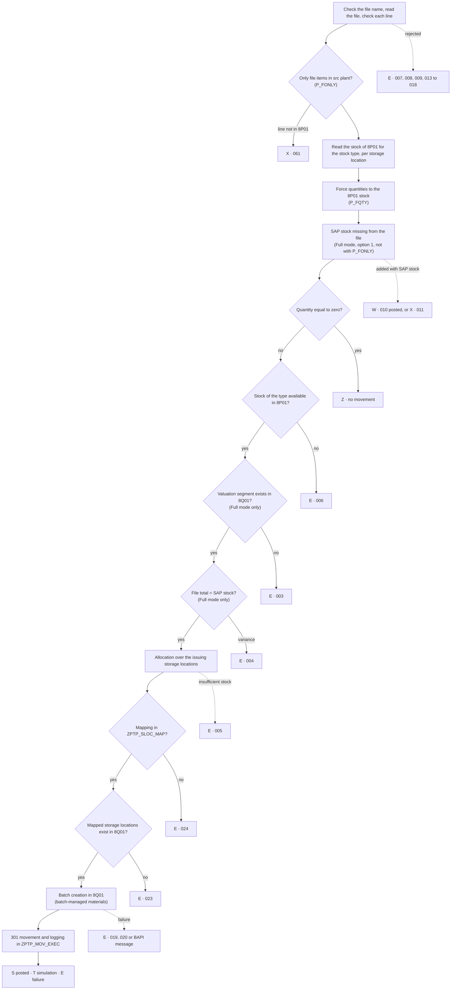

# ZPTP_SPLIT_VAL_MIG — Functional Specification and User Guide

2026-11-11 · program v1.33 (aligned on the source)

## 1. Purpose and scope

Program ZPTP_SPLIT_VAL_MIG transfers stock from source plant 8P01 to the new plant 8Q01, where split valuation is active, with movement type 301 (one-step plant-to-plant transfer). The input file provides the material / batch / valuation type mapping and the quantities.

**What the program does:**

- reads the stock of the source plant, per storage location, for the stock type chosen for the run;
- reconciles that stock with the input file and checks the data (valuation segment, quantities, units, batches, storage locations);
- creates missing batches in the target plant, with the attributes of the source batch and the target valuation type;
- posts the 301 movement (with the 343 / 321 and 344 / 322 movements around it for blocked and quality-inspection stock), with the target valuation type;
- logs every processed line in a log table and displays the result in an ALV list;
- in Online mode, lets the user post the lines one by one, or a selection of lines, from the ALV list.

**Stock types handled** (one type per run, see 3.4):

| Type | Source | Movements |
| --- | --- | --- |
| 1 Unrestricted | MCHB-CLABS / MARD-LABST | 301 |
| 2 Blocked | MCHB-CSPEM / MARD-SPEME | 343, 301, 344 |
| 3 Quality inspection without inspection lot | MCHB-CINSM / MARD-INSME, minus the quantity held by open inspection lots | 321, 301, 322 |
| 4 Project stock (special stock Q) | MSPR-PRLAB | 301 Q to the same WBS element, no input file |

**Materials handled:** batch-managed and non-batch-managed materials (types 1 to 3); batch-managed materials only for project stock (type 4).

**Out of scope:**

- quality-inspection stock held by an open inspection lot: it stays in the source plant (logged, message 055);
- other special stocks: sales order stock (E), consignment (K), stock at vendor (O). They stay in the source plant and are not reported;
- batch classification: class characteristics are not copied;
- company-code-level valuation: the program assumes valuation at plant level.

**Intended use:** one-off migration, run by the migration team, always in simulation first and then for real.

**Assumptions:**

- every storage location of the source plant holding stock has an entry in the mapping table ZPTP_SLOC_MAP, pointing to a storage location that exists in the target plant;
- file quantities are in the material's base unit of measure;
- a batch carries a single valuation type.

## 2. Processing flow

### 2.0 What drives the run

For stock types 1 to 3, the two processing options (block "Processing option", see 3.3) start from opposite sides and are complementary. Project stock (stock type 4) has its own logic, whatever the processing option.

| | Option 1 — Split Valuation Materials (P_SPLIT), types 1 to 3 | Option 2 — Non split valuation materials (P_NONSPL), types 1 to 3 | Project stock (P_XPRJ, type 4), any option |
| --- | --- | --- | --- |
| Driven by | **The input file** | **SAP stock of the source plant** | **SAP project stock of the source plant** (MSPR) |
| Role of the file | Defines what is moved: material, batch, valuation type and quantity of every line | Exclusion list only: its materials are left out; batches, valuation types and quantities are ignored | **None: no file is read.** A file prepared for option 1 has no effect, even if it lists the same batches |
| Role of SAP stock | Confirms that the stock is there (006), equals the file (004, Full mode) and covers each line (005) | Gives the lines: every material + batch **not** in the file, with its whole stock | Gives the lines: every material + batch + WBS element in project stock, with its whole project stock |
| Stock in SAP but not in the file | Added and posted with warning 010 (Full mode), unless P_FONLY is ticked | This is precisely what is transferred | Not applicable (no file) |
| Valuation type | From the file; must exist in the target plant (003, Full mode) | None: the material must **not** be split-valuated in the target plant (025) | Determined in the target plant, never from a file: the valuation type of the batch in the target plant, else the one of table ZPTP_301_VALTYPE (set on the batch, or used to create it). Same rule for split-valuated and non-split materials |
| Movement | 301 (with 343 / 344 or 321 / 322 for types 2 and 3) | 301 (idem), without valuation type | 301 Q to the same WBS element |
| Main checks | File line checks, valuation segment, quantity check | Material extended to the target plant (014), same batch management (026), not split-valuated (025) | Material extended to and batch-managed in the target plant (014, 026), ZPTP_301_VALTYPE entry (058) |
| Parameters that do not apply | — | P_FULL / P_DIR, P_NOQTY, P_FQTY, P_FONLY | P_SPLIT / P_NONSPL, P_FILE, P_FULL / P_DIR, P_NOQTY, P_FQTY, P_FONLY, P_ZBAT, file name check |

Option 1 moves what the file defines; option 2 moves everything else in the source plant that is not split-valuated in the target plant. Run with the same file, the two options cover the source plant, except split-valuated materials missing from the file. Project stock is transferred in a separate run (stock type 4), driven by SAP whatever the processing option: the split / non-split choice is ignored, and the valuation type of a split-valuated material comes from the target plant (batch or ZPTP_301_VALTYPE), not from the input file (see 3.4).

The rest of this section describes option 1. Option 2 builds its lines from SAP stock, then processes them with the same steps from 2.2 onwards (without checks 3 and 4).

**Option 1 flow.** Each input file line goes through a sequence of checks. At the first failed check, the line stops with a status and a message, and nothing is posted for it. The other lines carry on.



In Online mode (see 2.4) the preparation runs in the same way, then the flow stops before "Quantity equal to zero?": the lines wait in the ALV list with status R until the user posts them.

### 2.1 Preparation (once per run)

1. **File name check (v1.11).** The name of the input file (without its directory, case-insensitive) must match the stock type: it contains UNRESTRICTED (type 1), BLOCK (type 2), or QI but not QI_LOT (type 3). Otherwise the run stops with an error before anything is read. P_NOFNM turns the check off. The names proposed by ZPTP_SPLIT_VAL_MIG_UTILITY pass it.
2. **File reading.** Each line is split on the separator. An unusable line is rejected and logged with status E: layout error or material number that cannot be converted (009), non-numeric quantity (007), negative quantity (008) or unknown unit (017).
3. **Line checks.** Material type filter (S_MTART); the unit against the base unit (018); the consistency of NO_BATCH declarations with the material master (013, 014, 015); placeholder batch values reduced to blank (warning 012); batch number normalisation (see 4.3); a single valuation type per batch (016).
4. **Only file items in the source plant (v1.33, P_FONLY).** A line whose material is not extended to the source plant, or whose batch does not exist there (MCHA), is left out with status X (061).
5. **Aggregation.** File quantities are summed per material + batch for the quantity check.
6. **SAP stock reading.** Stock of the type transferred in the source plant, per storage location (MCHB for batch-managed materials, MARD for the others). A material is batch-managed when MARC-XCHPF of the plant or MARA-XCHPF is set. Type 3: the quantity held by open stock-relevant inspection lots (QALS-LMENGEZUB) is left out and logged (055).
7. **Error reprocessing (P_REPRC).** Only the lines in error in the previous sequence of the RUN_ID are kept (see 6.1).
8. **Forced quantity (v1.12, P_FQTY).** The quantity of each line is replaced by the whole stock of its material + batch (see 3.2).
9. **SAP stock missing from the file (v1.6).** A material + batch with stock of the type moved in the source plant and no line in the file is added as a line of its own, with the SAP stock, and posted with warning 010. Valuation type: the one the file gives for the other batches of the material when they all agree, else the first valuation type of the material in the target plant, none when the material is not split-valuated there. Split-valuated with no valuation type found: error 010, not posted. Stock of another type only (nothing to move): status X (011). Full Validation mode and option 1 only; skipped on an error-reprocessing run and with P_FONLY.
10. **Maximum number of materials (v1.4, P_MAXMT).** Only the first materials of the run are processed (file order; option 2: stock order). With a given RUN_ID, the lines already posted under it are skipped first, so that the next run takes the next materials. One W row (056) gives the numbers.
11. **Already transferred (v1.8).** A line whose material + batch was already posted for real (301, status S) between the same plants in an earlier run is still processed, with warning 057 giving the earlier RUN_ID and document.

### 2.2 Processing of each line

1. **Zero quantity**: status Z, no movement (with P_ZBAT: batch created, see 3.3).
2. **Stock available**: no stock of the type moved for the material/batch in the source plant gives status E (006).
3. **Valuation segment** (Full mode only): the file's valuation type must exist in the target plant (MBEW), otherwise E (003).
4. **Quantity** (Full mode only, unless P_NOQTY): the file total per material + batch must equal the SAP stock of the type moved, to three decimals, otherwise E (004).
5. **Storage location allocation**: the quantity is taken from the storage locations holding the stock, largest first. If the remaining stock does not cover the line, E (005); no partial issue is made.
6. **Receiving storage locations**: each issuing storage location is mapped to a receiving storage location through table ZPTP_SLOC_MAP (source plant + storage location → target plant + storage location). No entry: E (024). Mapped storage location missing in the target plant (T001L): E (023).
7. **Batch creation** (batch-managed materials): if the batch does not exist in the target plant, it is created with the attributes of the source batch and the target valuation type. A batch that already exists with another valuation type blocks the line (019). In simulation, the batch is not created.
8. **Movements**: one material document per line and movement, one item per issuing storage location, posting date = P_BUDAT. Type 1: the 301; the document and its log rows are committed together. Types 2 and 3: see 3.4.

Checks 5 and 6 run before batch creation, so no batch is created for a line that cannot be posted. The 301 carries the valuation type only when the material is split-valuated in the target plant.

### 2.3 Validation modes

| Mode | Parameter | Checks 3 and 4, SAP stock missing from the file | Use |
| --- | --- | --- | --- |
| Full Validation | P_FULL (default) | run | standard case: only fully valid lines are transferred |
| Direct Transfer | P_DIR | skipped | materials whose split valuation is not yet active in the target plant |

In both modes, the line checks, the stock check, the allocation, the storage location checks and batch creation apply. Option 2 and project stock always run their own checks: P_FULL / P_DIR do not apply to them.

### 2.4 Execution modes: Background and Online (v1.13)

| Mode | Parameter | Behaviour |
| --- | --- | --- |
| Background | P_BGD (default) | Every line is processed and posted in one run, in dialog or as a background job (P_JOB). |
| Online | P_ONL | Dialog only. The file is read and checked as in Background, but nothing is posted: the ALV lists one row per line with status **R** (ready) and the quantity that would be posted. The user posts lines from the list. |

**Online mode in detail:**

- Lines that cannot be posted (rejected by a file check, or zero quantity without P_ZBAT) are processed and logged at once, as in Background.
- **Selecting lines:** tick lines in the selection column. A **double-click** on a row ticks every row of that material and unticks the others; a second double-click on a material already fully ticked unticks it.
- **Post button:** posts every ticked line that is ready, or that failed at an earlier posting, after **one confirmation**. The lines are posted one after the other in file order (the order of Background mode, which matters when several lines share a material + batch). Each line goes through exactly the checks and postings of section 2.2, is logged in ZPTP_MOV_EXEC under the same RUN_ID and sequence, and its row is replaced by the result rows. A message gives the totals (posted, failed, failed reversal, skipped).
- A line already posted, or with nothing to post, is skipped. A line that failed can be posted again once the cause is fixed. In types 2 and 3, a line whose 301 and reversal both failed is closed: the stock must be put back by hand first.
- **Simulation does not apply:** the Simulation checkbox is hidden and ignored, every Post is real. To check the whole file without posting, run Background with Simulation first.
- Not with P_JOB, and not in a background job.
- All options and stock types, including project stock.

### 2.5 Simulation and real run

In simulation (P_TEST checked, the default, Background mode), the program runs every check and calls BAPI_GOODSMVT_CREATE in test mode followed by a rollback: SAP checks the movement without writing any stock. Valid lines are logged with status T and the material document column shows SIMULATED. Batches are not created; the source batch is still read, so an unreadable source batch (020) shows up in simulation. In types 2 and 3 only the first movement (343 / 321) can be simulated, because the 301 needs the stock it moves. Simulated lines are never counted as already transferred (057) or as posted by P_MAXMT. By default (P_NOLOG checked) a simulation is not logged: its result is only in the ALV list. Uncheck P_NOLOG to keep it in the log tables. To post for real, uncheck P_TEST.

## 3. Selection screen

The blocks appear in this order: Execution mode, Run control (with the sub-blocks Input file and Maintenance), Processing option, Stock type transferred, Organizational data. Each parameter is labelled *label (technical name)*. Consistency checks run only on execution (F8, background job, print), not on every change on the screen. When the deletion option P_DEL is checked, only the RUN_ID is checked.

### 3.1 Block "Execution mode" (v1.15)

| Parameter | Label | Mandatory | Default | Meaning and behaviour |
| --- | --- | --- | --- | --- |
| P_ONL | Online - post line by line | exclusive choice | — | Online mode, see 2.4. Hides P_TEST. |
| P_BGD | Background - all lines | exclusive choice | checked | Every line is processed in one run, as before (dialog, or job with P_JOB). |
| P_JOB | Run as background job | no | unchecked | With Background: F8 schedules the run as a background job started immediately (job ZPTP_SPLIT_VAL_MIG, SM37) with the same selection, and shows the job number and the RUN_ID. The file must be on the application server (P_SRV). Refused with Online. |
| P_TEST | Simulation | no | checked | Checked: simulation, no stock posting and no batch creation (see 2.5). Unchecked: real run. Hidden and ignored in Online mode. |
| P_NOLOG | Simulation without log | no | checked | With P_TEST checked: nothing is written to ZPTP_MOV_EXEC or ZPTP_BATCH_EXT; the result is in the ALV list (spool in a job) only, and no RUN_ID sequence is used. Unchecked: the simulation is logged with the simulation flag. Display-only when P_TEST is unchecked (a real run is always logged); hidden in Online mode. |

### 3.2 Block "Run control"

| Parameter | Label | Mandatory | Default | Meaning and behaviour |
| --- | --- | --- | --- | --- |
| P_FULL | Full validation | exclusive choice | checked | Standard mode: all checks apply (see 2.3). |
| P_DIR | Direct transfer | exclusive choice | — | Skips the valuation segment check, the quantity check and the "SAP stock missing from the file" step (see 2.3). |
| P_NOQTY | Deactivate qty check vs file | no | unchecked | Skips the quantity check (004). The other checks, the allocation and the reconciliation stay active. |
| P_NOFNM | Deactivate file name check | no | unchecked | Skips the file name check (see 2.1). |
| P_FQTY | Force qty to source stock | no | unchecked | Option 1, stock types 1 to 3: each file line is transferred with the whole stock of its material + batch in the source plant for the stock type chosen, instead of the file quantity. Several lines for one material + batch: the first line with a quantity takes the stock, the others 0. No stock: status Z. File Qty keeps the file value; a changed line carries warning 060. The quantity check then passes; all other checks still run. Ignored by option 2 and project stock, which always move the whole stock. |
| P_SVPOS | Only SAP variance >= 0 | no | unchecked | The ALV shows only the rows whose SAP Variance (see 5.2) is 0 or more. Background: display only, every line is still processed and logged. Online: the hidden lines are not listed, so they cannot be posted. |
| P_FONLY | Only file items in src plant | no | unchecked | Option 1 only. Only the materials and batches of the file that exist in the source plant are treated: a file line whose material is not extended to the source plant or whose batch does not exist there is left out with status X (061), and SAP stock not in the file is not added (no 010 / 011 rows). Unchecked: as before. |
| S_STAT | ALV status | no | blank | Restricts the ALV list to the selected status values (see 5.1); several values, ranges or exclusions can be entered, and F4 lists the values with their meaning. Blank: all values. Display only: every line is still processed and logged in ZPTP_MOV_EXEC. In Online mode, ready lines (R) hidden by the filter cannot be posted. If no row matches, a message is shown instead of the list. |

#### Sub-block "Input file"

| Parameter | Label | Mandatory | Default | Meaning and behaviour |
| --- | --- | --- | --- | --- |
| P_SRV | Application server | exclusive choice | — | The file is read on the application server. The only possible choice in background. |
| P_LOC | Local file | exclusive choice | checked | The file is uploaded from the workstation (GUI). Requires a dialog run: for a background job, select P_SRV. |
| P_FILE | Input file path | yes | blank | Full path of the file. F4 help opens the server directory or workstation file browser, depending on the choice above. The program checks that the file exists and is readable, and that its name matches the stock type (see 2.1), before starting. Not used by project stock. |
| P_SEP | Field separator | yes | ; | Column separator character of the file. |

#### Sub-block "Maintenance"

| Parameter | Label | Mandatory | Default | Meaning and behaviour |
| --- | --- | --- | --- | --- |
| P_RUNID | Run ID, blank=new | no | blank | Run identifier. Blank: a new identifier HBM + date + time is generated. Filled: the run is attached to this RUN_ID with the next sequence (001, 002, …). Required with P_REPRC and P_DEL. |
| P_REPRC | Reprocess errors | no | unchecked | Reprocesses only the lines with status E in the previous sequence of the RUN_ID. Requires a RUN_ID that exists in ZPTP_MOV_EXEC. |
| P_DEL | Delete run ID | no | unchecked | Deletes the rows of the entered RUN_ID from both log tables, after confirmation. No other processing is run. See section 6. |
| P_CLR | Delete all logs before the run | no | unchecked | Empties ZPTP_MOV_EXEC and ZPTP_BATCH_EXT completely, then runs the migration normally (the RUN_ID sequence restarts at 001). Needs the table authorization (S_TABU_NAM) on both tables and a confirmation popup (none in background). The log of runs that posted documents is deleted too. Cannot be combined with P_REPRC. |

### 3.3 Block "Processing option"

| Parameter | Label | Default | Meaning and behaviour |
| --- | --- | --- | --- |
| P_SPLIT | Split Valuation Materials | checked | Option 1: the materials of the input file are transferred, with the valuation types and quantities of the file. |
| P_NONSPL | Non split valuation materials | — | Option 2: every material with stock of the type moved in the source plant that is **not** in the input file is transferred with its whole stock. The batch is created in the target plant when missing (batch-managed materials), then the 301 is posted. The file is read only to know which materials to exclude (a material is excluded as soon as one line of the file carries it, even a rejected line); an empty file is refused. Checks: material extended to the target plant (014), same batch management in both plants (026), material **not** split-valuated in the target plant (025). No valuation type is read or posted. P_FULL / P_DIR, P_FQTY and P_FONLY do not apply. The filters S_MATNR, S_CHARG and S_MTART apply to the stock read. |
| P_ZBAT | Create batches with zero stock | unchecked | Both options. The batch is created in the target plant when missing, although the stock in the source plant is 0; **no movement** is posted. Option 1: file lines with quantity 0 and a batch (Full mode: the valuation type must exist in the target plant, 003). Option 2: batches of the source plant (not flagged for deletion) with no stock, for materials not in the file. Only batch-managed materials. Log status S (T in simulation). Unchecked: a zero line keeps status Z and no batch is created. |

### 3.4 Block "Stock type transferred"

| Parameter | Label | Default | Meaning and behaviour |
| --- | --- | --- | --- |
| P_XUNR | 1 Unrestricted stock | checked | One 301 movement per line. |
| P_XBLK | 2 Blocked stock | — | Three movements: **343** in the source plant (blocked → unrestricted), **301** with the valuation type of the file, **344** in the target plant (unrestricted → blocked). |
| P_XQI | 3 QI stock without insp. lot | — | Three movements: **321** in the source plant (QI → unrestricted), **301**, **322** in the target plant (unrestricted → QI). Only the QI quantity not held by an open stock-relevant inspection lot is moved; the lot stock stays in the source plant (055). |
| P_XPRJ | 4 Project stock (Q) | — | Project stock, no input file, see below. |

To migrate every stock type, run once per type, with a file built by the utility for that type (types 1 to 3).

**Types 2 and 3:**
- One material document per movement, committed before the next movement, since each movement needs the stock left by the previous one. The 343 / 321 and 344 / 322 items use the same storage locations as the 301 (issuing locations in the source plant, ZPTP_SLOC_MAP locations in the target plant); the 344 / 322 item carries the target valuation type.
- The 301 fails: the first movement is reversed in the source plant (344 / 322) and the line ends with status E; the message gives both documents. If the reversal also fails, the message says so and which movement to post manually.
- The last movement fails: status **W**. The 343 / 321 and 301 are posted, the stock is unrestricted in the target plant, and the message says which movement to post manually. A W line is not reprocessed by P_REPRC.
- The file quantity is compared with the stock being moved (blocked stock; QI stock without inspection lot).
- A run holding any real document (status S or W) cannot be deleted with P_DEL.

**Type 4, project stock (v1.9):**
- The batches held in project stock (special stock Q, MSPR-PRLAB, unrestricted) in the source plant that match the selection (material, batch, material type) are transferred to the **same WBS element** in the target plant with one 301 Q per material + batch + WBS element (one item per storage location, mapped by ZPTP_SLOC_MAP). No input file: the quantities are the project stock.
- The material must be extended to and batch-managed in the target plant (014, 026).
- Valuation type, determined in the target plant: batch in the target plant with a valuation type → that one; batch without valuation type → the valuation type of table ZPTP_301_VALTYPE is set in the batch master (059); no batch → the batch is created with the attributes of the source batch and the valuation type of ZPTP_301_VALTYPE.
- ZPTP_301_VALTYPE: active entries of the fiscal year of the posting date, most specific first: plant + material type, plant, material type, generic. No entry: 058.
- A line that cannot be transferred is logged with status W and skipped; the next one is processed.
- **SAP drives the run, for split-valuated and non-split materials alike.** P_SPLIT / P_NONSPL are ignored: both give the same result. No input file is read, so the valuation type of a split-valuated material is never taken from a file, even when a file of option 1 lists the same batch; it always comes from the batch in the target plant or from ZPTP_301_VALTYPE.
- P_FILE, the file name check, P_FULL / P_DIR, P_NOQTY, P_FQTY, P_FONLY and P_ZBAT do not apply.

### 3.5 Block "Organizational data"

| Parameter | Label | Mandatory | Default | Meaning and behaviour |
| --- | --- | --- | --- | --- |
| P_WSRC | Source plant | yes | 8P01 | Issuing plant whose stock is read and transferred. Must exist in T001W and differ from the target plant. |
| P_WDST | Target plant | yes | 8Q01 | Receiving plant, where split valuation is active. Must exist in T001W. Valuation segments, batches and storage locations are checked in this plant. |
| S_MATNR | Material | no | blank | Restricts processing to some materials, both in the stock read and in the file. |
| S_CHARG | Batch | no | blank | Restricts processing to some batches, in the stock and in the file. |
| S_MTART | Material type | no | blank | Restricts processing to some material types (MARA-MTART). A material excluded by this filter is skipped without a message. |
| P_BUDAT | Posting date | yes on execution | today | Posting date of the movements. Also checked in background. |
| P_MAXMT | Max. materials per run | no | 9 999 999 | Maximum number of materials processed in the run, 0 = no limit (see 2.1). |

With any of the three filters S_MATNR, S_CHARG or S_MTART, the "SAP stock missing from the file" step only covers the filtered scope.

## 4. Input file format

The input file is a flat text file with one line per material / batch / valuation type combination and five columns in a fixed order. It is needed for stock types 1 to 3, both options (option 2 uses it as an exclusion list); project stock reads no file.

### 4.1 Columns

| Position | Column | Mandatory | Content and rules |
| --- | --- | --- | --- |
| 1 | MATNR | yes | Material number, with or without leading zeros (standard SAP conversion). Blank: line rejected (009). |
| 2 | CHARG | no | Batch number for a batch-managed material (see 4.3). For a non-batch-managed material: NO_BATCH or blank. |
| 3 | BWTAR | yes | Target valuation type in plant 8Q01. Blank: line rejected (009). |
| 4 | QUANTITY | yes | Quantity to transfer, in the material's base unit. Non-numeric: rejected (007). Negative: rejected (008). Zero: no movement (status Z). Replaced by the source stock with P_FQTY. |
| 5 | UOM | no | Unit of measure. Must be the material's base unit (MARA-MEINS). Unknown: rejected (017). Different from the base unit: rejected (018). Blank: the base unit is used. |

**Unit of measure and special characters.** The unit is converted from its external form (for example PC to ST), in the logon language, then English, then as internal unit. It is tried as typed, then in upper case, each time with the micro sign (U+00B5) and with the Greek small mu (U+03BC), so units such as μg or μL are recognised whichever character the file carries. A local file is read as bytes and decoded as UTF-8, falling back to Windows-1252.

Extra columns after the fifth are ignored. A line with fewer than five columns is rejected (009), except the first line, which is then taken as a header and skipped.

**Not in the file:** storage location, plants, movement type and posting date. The issuing storage locations come from SAP stock, the plants and the date from the selection screen, and the movements from the stock type.

**File name:** must match the stock type (see 2.1), for example `ZPTP_SPLIT_VAL_8P01_8Q01_UNRESTRICTED_20261111.csv`.

### 4.2 Format rules

| Property | Rule |
| --- | --- |
| Separator | The one in P_SEP, default `;`. It must not appear inside a value: no quoting or escaping. |
| Header line | Optional. The first line is skipped when its 4th column is not numeric or when it has fewer than five columns. |
| Empty lines | Ignored anywhere in the file. |
| Decimals | Point or comma accepted. No thousands separator. |
| Blanks and case | Blanks around values are removed; carriage returns, BOM, zero-width and non-breaking spaces are cleaned. Batch, valuation type and unit are converted to upper case. |
| Line endings | Transfer a server file in text mode, otherwise a stray carriage return may end up in the unit. |

### 4.3 Batch column

| Value | Interpretation | Message |
| --- | --- | --- |
| Batch number | Batch-managed material: batch to transfer, created in the target plant if needed. | — |
| NO_BATCH (or NOBATCH, NO-BATCH, NO BATCH, case-insensitive) | Declaration: the material is batch-managed neither in the source plant nor in the target plant. No batch is created; the 301 carries the valuation type only. ZPTP_SPLIT_VAL_MIG_UTILITY writes NO_BATCH for non-batch-managed materials. | none; blocked if the material master contradicts the declaration (013, 014, 015) |
| Blank | Non-batch-managed material: transferred without batch. Unlike NO_BATCH, a blank is not checked against the material master; on a batch-managed material it finds no stock. | none; 006 on a batch-managed material |
| N/A, NA, NONE, NULL, -, --, #, . | Placeholder value, reduced to blank. | warning 012 |
| Any other value on a non-batch-managed material | Reduced to blank. | warning 012 |

**Leading zeros (v1.10).** A numeric batch is normalised to 10 characters with leading zeros (123 → 0000000123) and looked up in that form among the batches of the source plant (MCHA). When it does not exist there, the batch without leading zeros is tried (123). The batch found replaces the file value for every later step. When neither exists, the normalised value is kept. Non-numeric batches are compared as written, in upper case. A partly padded value (00123) matches neither form.

**Batch with "," or "." (v1.35).** Applies to every file line whose batch contains at least one comma or full stop:

1. The batch is looked up in the source plant (material + plant + batch, MCHA) exactly as written. Found: it is used.
2. Not found: an alternative is built by replacing every "," with "." and every "." with "," (24.105 → 24,105) and looked up again. Found: that SAP batch is used.
3. Neither exists: the line fails, "batch not found" (062), with both values in the message.

- The original takes priority: when both exist, the original is used and a warning row (063) points to possible duplicate batches.
- A match by the alternative is recorded on every log row of the line: CHARG = batch used in SAP, CHARG_FILE = batch of the file, PUNCT_SUB = X (ALV columns *Batch*, *File batch*, *Punct. swapped*).
- All later steps (batch creation, goods movements) use the batch as it exists in SAP. The file is never changed.
- Batches without "," or "." follow the leading-zero rule above.
- The same rule applies in ZPTP_SPLIT_VAL_BATCH_COPY.

A batch can carry only one valuation type. A batch that appears on several lines with different valuation types is rejected (016); lines with quantity zero are not counted.

### 4.4 Example

```csv
MATNR;CHARG;BWTAR;QUANTITY;UOM
100234;0000004711;VT01;150,000;KG
100234;4712;VT02;80,000;KG
200987;NO_BATCH;VT01;1250,000;PC
300555;;VT02;0,000;L
```

- Line 1: header, skipped.
- Lines 2 and 3: two batches of the same material, each with its own valuation type; batch 4712 is looked up as 0000004712 first, then as 4712.
- Line 4: non-batch-managed material, declared NO_BATCH.
- Line 5: blank batch and zero quantity, status Z, no movement.

### 4.5 Quantity check

In Full Validation mode, the sum of the file quantities for a given material + batch must equal the SAP stock of the type moved in the source plant, across all storage locations, to three decimals. The file must therefore cover the full stock of each material/batch, split across its valuation types. P_NOQTY turns the check off; with P_FQTY it always passes.

## 5. Results

At the end of the run, the program displays an ALV list with one row per processed line and per issuing storage location. The same rows are logged in table ZPTP_MOV_EXEC. In Online mode the list first shows one row per ready line, replaced by the result rows when the line is posted.

**Detailed log.** In stock types 2 and 3 each movement gets its own rows: column *Mvt type* (BWART) = 343 / 321, 301, 344 / 322, each with its own material document; a reversal after a failed 301 is logged as a 344 / 322 row. Every run starts with one run-parameter row (054). To count one row per file line, filter on Mvt type = 301.

### 5.1 Statuses

| Status | Meaning | Movement posted |
| --- | --- | --- |
| S | Success: movement posted, document number filled | yes |
| T | Simulation: the line would have been posted | no |
| R | Ready to post (Online mode, list only, not logged) | not yet |
| Z | Zero quantity | no |
| E | Error: line rejected or blocked, see the message | no |
| W | Warning: run information (054, 056), last movement failed (types 2 / 3), project stock line skipped (type 4), QI held by inspection lots (055) | depends on the line |
| X | Not processed: SAP stock not in the file with nothing to move (011), or file line not in the source plant with P_FONLY (061) | no |
| I | Inconsistency (no longer produced since v1.6, still accepted by S_STAT) | no |

A line posted with a warning of its own (010 added from SAP stock, 057 already transferred, 060 quantity forced) keeps status S and shows its success message (v1.28); the warning stays on the rows that were not posted.

### 5.2 ALV list

**Order.** Background: rows grouped by status in the order T, S, E, W, Z, I, X, R, with a separator line between two statuses; inside a status, sorted by message, material, batch and issuing storage location. Online: in file order (column *Line*), so that a line keeps its place when it is posted.

**Colours.**
- Whole row: red for an error (status E, message type E, A or I), green for a posted or simulated row (S, T), yellow for a warning (W).
- Rows without a result colour (ready lines in Online mode) alternate between white and light blue at each change of material.
- SAP Variance cell: green when 0 or more, red when negative.

**Columns:** Line (Online only), RUN_ID, status, material, batch, batch-management flag, valuation type, WBS element (project stock only), issuing plant and storage location, receiving plant and storage location, quantity posted, unit, file quantity, SAP stock, File Variance, SAP Variance, movement type, material document and year, message type, message number, message text, sequence, mode, simulation flag and batch-normalised flag. The message class is hidden (it can be shown with the layout button).

| Column | Content |
| --- | --- |
| BatchMgd | Set on every row of a material batch-managed in the source plant (else the target plant), from the material master (v1.21). |
| Qty Posted | Quantity of the posting row: the share of the line issued from that storage location. On an error row after the allocation, the quantity that was attempted. In Online mode, on a ready row, the quantity that would be posted. |
| File Qty | Quantity of the file line (before forcing, with P_FQTY). |
| SAP Stock | Stock of the type moved in the source plant for the material + batch, all storage locations, read at the start of the run. |
| File Variance | File total for the material + batch minus SAP Stock (quantity check 4.5). 0 when the check does not run. |
| SAP Variance | SAP stock of the material + batch (+ WBS element for project stock) minus the quantity the run transfers for it: the file quantities, the forced quantities, or the whole stock (option 2, project stock), lines rejected by a check excluded, whether posted yet or not. 0: the run takes the whole stock; positive: stock left in the source plant; negative: more to transfer than the stock — red cell and a warning at the end of the message. List only, not logged. |

The issuing storage location is where the stock currently is; the receiving storage location is the one mapped to it in ZPTP_SLOC_MAP. A line with no stock (006) has no storage location.

### 5.3 Log tables

| Table | Content | Key |
| --- | --- | --- |
| ZPTP_MOV_EXEC | One row per processed line, movement and issuing storage location: run context, material, batch (as in SAP), batch of the file and punctuation-swapped flag (v1.35), batch-management flag, plants, storage locations, valuation type, movement type, quantities, file variance, posting date, material document, status and message | RUN_ID, RUN_SEQ, POSNR |
| ZPTP_BATCH_EXT | One row per batch handled in the target plant: created, already existing, valuation type set, simulated or failed | RUN_ID, RUN_SEQ, MATNR, CHARG, WERKS_DST |

A simulation with P_NOLOG checked (the default) writes no rows. Each material document is committed in the same logical unit of work as its log rows, so a posted document always has its log. If the update fails after the commit, the row is set back to status E (022).

### 5.4 Messages (class ZPTP_SPLIT_VAL)

| No. | Message | Status |
| --- | --- | --- |
| 002 | Zero quantity, no movement | Z |
| 003 | Valuation type missing in the target plant | E |
| 004 | Variance between the file quantity and SAP stock | E |
| 005 | Insufficient stock in the issuing storage locations | E |
| 006 | No stock of the type moved in the source plant for the material/batch | E |
| 007 | Non-numeric quantity, line rejected | E |
| 008 | Negative quantity, line rejected | E |
| 009 | Layout error (number of columns, mandatory field blank, material number) | E |
| 010 | Batch not in the file, posted with the SAP stock (warning on the line); E when split-valuated and no valuation type found | W / E |
| 011 | SAP stock not in the file, nothing of the type moved, not processed | X |
| 012 | Batch column reduced to blank (placeholder value or non-batch-managed material) | W |
| 013 | Batch-managed material declared NO_BATCH | E |
| 014 | Material not extended to one of the plants | E |
| 015 | Material declared NO_BATCH but holding batch stock in the source plant | E |
| 016 | Batch split across several valuation types | E |
| 017 | Unknown unit of measure | E |
| 018 | Unit different from the material's base unit | E |
| 019 | Batch already exists in the target plant with another valuation type | E |
| 020 | Source batch cannot be read in the source plant | E |
| 022 | Update failed after commit, document not posted | E |
| 023 | Mapped storage location missing in the target plant | E |
| 024 | No storage location mapping in ZPTP_SLOC_MAP for the issuing storage location | E |
| 025 | Material split-valuated in the target plant, not eligible for option 2 | E |
| 026 | Batch management differs between the two plants (option 2, project stock) | E / W |
| 054 | Run parameters (option, stock type, quantity check, forced quantity, only file items, file name check, mode, zero-stock batches, reprocess, max. materials, Online), one row per run | W |
| 055 | Type 3: QI stock held by open inspection lots stays in the source plant (per material / batch / storage location) | W |
| 056 | Maximum number of materials: processed and left for a next run | W |
| 057 | Batch already transferred in an earlier run (RUN_ID, date, document) | W |
| 058 | Project stock: no active entry in ZPTP_301_VALTYPE for the plant, material type and fiscal year | W |
| 059 | Project stock: valuation type set on the batch in the target plant | S |
| 060 | Quantity of the line forced to the stock of the source plant (P_FQTY), file quantity in brackets | W |
| 061 | File line not in the source plant (material not extended or batch missing), not treated (P_FONLY) | X |
| 062 | Batch with "," or "." not found as written nor with the punctuation swapped (both values shown) | E |
| 063 | Both forms of a batch with "," or "." exist; the original is used (possible duplicate batches) | W |

Errors returned by the SAP BAPIs (batch creation, goods movement) are logged with their own message class and number.

## 5b. Companion programs

| Program | Purpose |
| --- | --- |
| ZPTP_SPLIT_VAL_MIG_UTILITY (transaction ZPTP_SPLIT_VAL_UTIL) | Builds the CSV input file from SAP stock and the valuation types of the target plant. The stock extracted is chosen like the stock type of the migration: unrestricted (default), blocked, or QI without inspection lot (open stock-relevant inspection lots deducted per storage location). Run it with the same choice as the migration so the file passes the quantity check and the file name check. Option 4 extracts only the QI stock held by open inspection lots, for analysis: the migration does not transfer that stock. Execution mode: **Online** (default) downloads the file to the PC through a save dialog; **Background** runs a job that writes the file to an application-server directory (default /tmp). Valuation type, from plant 2: batch-managed materials take the valuation type of the batch master in plant 2 (batch missing or without valuation type: line rejected); non-batch materials take the first valuation type in alphabetical order with a non-zero standard price; materials not split-valuated in plant 2 are written per batch with a blank valuation type. Non-batch-managed materials are written with NO_BATCH in the batch column. Project stock (MSPR) is not extracted. |
| ZPTP_SPLIT_VAL_MIG_UPLOAD (transaction ZPTP_SPLIT_VAL_UPLD) | Dialog only. Copies a file from the PC to the application server (binary copy, confirmation before overwriting), so that ZPTP_SPLIT_VAL_MIG can run as a background job with P_SRV. |
| ZPTP_SPLIT_VAL_BATCH_COPY (transaction ZPTP_SPLIT_VAL_BCPY) | Extends every batch of the source plant (MCHA, not flagged for deletion, optional selection by material and batch) to the target plant. Material split-valuated in the target plant: the valuation type is taken from the file line with the same material + batch (batch matched with leading zeros first, then without); no line: error, batch not copied. Material not split-valuated: the batch is copied without valuation type. File lines that match no source batch are listed as errors. Online mode lists the items; ticked rows are created with the "Post" button. Background mode processes every item in one run (P_TEST applies). |

## 6. Restart, maintenance and open points

### 6.1 Error reprocessing

Each run has a RUN_ID and a sequence (001, 002, …) computed automatically. The full history is kept.

Recommended approach:

1. Run a simulation (Background, P_TEST checked) on the complete file and analyse the lines in status E.
2. Correct the data (file, material master, valuation segments, storage location mapping, storage locations of the target plant).
3. Rerun in simulation until no blocking error remains.
4. Run for real: Background with P_TEST unchecked, or Online to post the lines one by one or by material.
5. For lines still in status E: enter the RUN_ID, check P_REPRC and rerun. Only the status E lines of the previous sequence are reprocessed. In Online mode, a failed line can also be posted again directly from the list once the cause is fixed.

Lines added from SAP stock that failed for lack of a valuation type (010, E) need a file line: complete the file and start a normal run.

### 6.2 Deleting a RUN_ID

P_DEL checked with a RUN_ID deletes that RUN_ID's rows from ZPTP_MOV_EXEC and ZPTP_BATCH_EXT, after a confirmation popup. No stock and no SAP standard data are changed.

Deletion is refused if the RUN_ID contains documents actually posted (status S or W, not a simulation): the log of real postings is the audit trail. It requires authorization S_TABU_NAM (activity 02, table ZPTP_MOV_EXEC).

P_CLR checked empties both log tables completely before a normal run, whatever the RUN_ID, and also removes the log of real postings. It requires S_TABU_NAM (activity 02) on ZPTP_MOV_EXEC and ZPTP_BATCH_EXT, a confirmation popup in dialog mode, and cannot be combined with P_REPRC.

### 6.3 Authorizations

- Goods movements and batch creation / change: standard checks of the SAP BAPIs (BAPI_GOODSMVT_CREATE, BAPI_BATCH_CREATE, BAPI_BATCH_CHANGE).
- Background job: S_BTCH_JOB to release the job, otherwise release it in SM37.
- Deletion of a RUN_ID or of all the logs (P_CLR): S_TABU_NAM.
- No program-specific authorization check on execution is in place yet.

### 6.4 Points to confirm

- [ ] Storage location allocation rule: largest first (implemented) or pro rata.
- [ ] Valuation at plant level (MBEW-BWKEY = target plant): to confirm for the HBM system.
- [ ] ZPTP_SLOC_MAP filled for every storage location of 8P01 holding stock, and its target storage locations created in 8Q01.
- [ ] Material data of the receiving storage locations in 8Q01 (MARD): created automatically by the 301 only if automatic creation is allowed (OMB3); otherwise the posting fails with an SAP message.
- [ ] Handling of a batch split across several valuation types: correct the file or use new batch numbers.
- [ ] List of placeholder values in the batch column, to check against the actual HBM extract.
- [ ] Batch-management indicator actually maintained by HBM: MARC-XCHPF, MARA-XCHPF or both.
- [ ] ZPTP_301_VALTYPE maintained for the fiscal year of the posting date (project stock).
- [ ] Copy of batch classification, not done at this stage.
- [ ] Authorization check on execution, to be defined with the security team.
