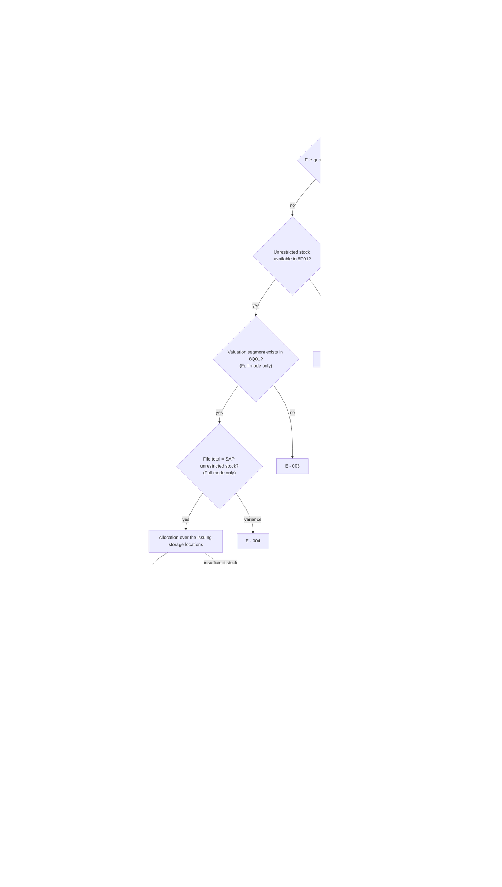

# ZPTP_SPLIT_VAL_MIG — Functional Specification and User Guide

2026-10-19 · program v1.1 (aligned on the source)

## 1. Purpose and scope

Program ZPTP_SPLIT_VAL_MIG transfers unrestricted stock from source plant 8P01 to the new plant 8Q01, where split valuation is active, with movement type 301 (one-step plant-to-plant transfer). The input file provides the material / batch / valuation type mapping and the quantities.

**What the program does:**

- reads the unrestricted stock of the source plant, per storage location;
- reconciles that stock with the input file and checks the data (valuation segment, quantities, units, batches);
- creates missing batches in the target plant, with the attributes of the source batch;
- posts one 301 movement per input file line, with the target valuation type;
- logs every processed line in a log table and displays the result in an ALV list.

**Materials handled:** batch-managed and non-batch-managed materials.

**Out of scope:**

- quality-inspection stock, blocked stock and special stocks: only unrestricted stock is read;
- batch classification: class characteristics are not copied;
- company-code-level valuation: the program assumes valuation at plant level.

**Intended use:** one-off migration, run by the migration team, always in simulation first and then for real.

**Assumptions:**

- every storage location of the source plant holding stock has an entry in the mapping table ZPTP_SLOC_MAP, pointing to a storage location that exists in the target plant;
- file quantities are in the material's base unit of measure;
- a batch carries a single valuation type.

## 2. Processing flow

Each input file line goes through a sequence of checks. At the first failed check, the line stops with a status and a message, and nothing is posted for it. The other lines carry on.



### 2.1 Preparation (once per run)

1. **File reading.** Each line is split on the separator. An unusable line is rejected and logged with status E: layout error or material number that cannot be converted (009), non-numeric quantity (007), negative quantity (008) or unknown unit (017).
2. **Line checks.** The program checks the unit against the base unit (018), a single valuation type per batch (016) and the consistency of NO_BATCH declarations with the material master (013, 014, 015). Placeholder batch values are reduced to blank (warning 012).
3. **Aggregation.** File quantities are summed per material + batch for the quantity check.
4. **SAP stock reading.** Unrestricted stock of the source plant per storage location: MCHB-CLABS for batch-managed materials, MARD-LABST for the others. A material is batch-managed when MARC-XCHPF of the source plant or MARA-XCHPF is set.
5. **Reverse reconciliation.** A material/batch in SAP stock but missing from the file is reported: status I (010) if a valuation segment already exists in the target plant, status X (011) otherwise. It is not transferred. This check runs in Full Validation mode only and is skipped on an error-reprocessing run. Stock of a material or batch already blocked by a line check is not reported a second time.

### 2.2 Processing of each line

1. **Zero quantity**: status Z, no movement.
2. **Unrestricted stock**: no unrestricted stock for the material/batch in the source plant gives status E (006).
3. **Valuation segment** (Full mode only): the file's valuation type must exist in the target plant (MBEW), otherwise E (003).
4. **Quantity** (Full mode only): the file total per material + batch must equal the SAP unrestricted stock, to three decimals, otherwise E (004).
5. **Storage location allocation**: the quantity is taken from the storage locations holding the stock, largest first. If the remaining stock does not cover the line, E (005); no partial issue is made.
6. **Receiving storage locations**: each issuing storage location is mapped to a receiving storage location through table ZPTP_SLOC_MAP (source plant + storage location → target plant + storage location). No entry: E (024). Mapped storage location missing in the target plant (T001L): E (023).
7. **Batch creation** (batch-managed materials): if the batch does not exist in the target plant, it is created with the attributes of the source batch and the target valuation type. A batch that already exists with another valuation type blocks the line (019). In simulation, the batch is not created.
8. **301 movement**: one material document per input file line, one item per issuing storage location, posting date = P_BUDAT. The document and its log rows are committed together.

Checks 5 and 6 run before batch creation, so no batch is created for a line that cannot be posted.

### 2.3 Execution modes

| Mode | Parameter | Checks 3 and 4, reverse reconciliation | Use |
| --- | --- | --- | --- |
| Full Validation | P_FULL (default) | run | standard case: only fully valid lines are transferred |
| Direct Transfer | P_DIR | skipped | materials whose split valuation is not yet active in the target plant; the 301 carries the valuation type only if the material is split-valuated in the target plant |

In both modes, the line checks, the unrestricted stock check, the allocation, the storage location check and batch creation apply.

### 2.4 Simulation and real run

In simulation (P_TEST checked, the default), the program runs every check and calls BAPI_GOODSMVT_CREATE in test mode followed by a rollback: SAP checks the movement without writing any stock. Valid lines are logged with status T and the material document column shows SIMULATED. Batches are not created; the source batch is still read, so an unreadable source batch (020) shows up in simulation. To post for real, uncheck P_TEST.

## 3. Selection screen

The screen has 30 parameters in seven blocks (the "Processing option" block was added in v0.7; the outer frame titled STOCKS & BATCHES MIGRATION PROGRAM was removed). Each parameter is labelled *label (technical name)*, for example *Source plant (P_WSRC)*. Consistency checks run only on execution (F8, background job, print), not on every change on the screen. When the deletion option P_DEL is checked, only the RUN_ID is checked.

### 3.0 Block "Processing option" (v0.7, P_ZBAT v0.8)

| Parameter | Label | Default | Meaning and behaviour |
| --- | --- | --- | --- |
| P_SPLIT | Split Valuation Materials | checked | Option 1: unchanged behaviour. The materials of the input file that have stock in the source plant are transferred. |
| P_NONSPL | Non split valuation materials | — | Option 2: every material with unrestricted stock in the source plant that is **not** in the input file is transferred with its whole unrestricted stock. The batch is created in the target plant when missing (batch-managed materials), then the 301 is posted. The file is read only to know which materials to exclude (a material is excluded as soon as one line of the file carries it, even a rejected line). Checks: material extended to the target plant (014), same batch management in both plants (026), material **not** split-valuated in the target plant (025). No valuation type is read or posted. P_FULL / P_DIR are ignored (these checks always run). Simulation, RUN_ID / reprocess, storage-location mapping and logging work as for option 1; the filters S_MATNR, S_CHARG and S_MTART apply to the stock read. |

| P_ZBAT | Create batches with zero stock | unchecked | Both options. The batch is created in the target plant when missing, although the unrestricted stock in the source plant is 0; **no movement** is posted. Option 1: file lines with quantity 0 and a batch (Full mode: the valuation type must exist in the target plant, 003). Option 2: batches of the source plant (not flagged for deletion) with no unrestricted stock, for materials not in the file. Only batch-managed materials. Log status S (T in simulation). Unchecked: a zero line keeps status Z and no batch is created. |

### 3.0a Block "Stock type transferred" (v1.0)

| Parameter | Label | Default | Meaning and behaviour |
| --- | --- | --- | --- |
| P_XUNR | 1 Unrestricted stock | checked | Unchanged behaviour: one 301 movement per file line. |
| P_XBLK | 2 Blocked stock | — | Blocked stock is moved in three movements: **343** in the source plant (blocked → unrestricted), **301** with the valuation type of the file, **344** in the target plant (unrestricted → blocked). |
| P_XQI | 3 QI stock without inspection lot | — | Quality inspection stock is moved in three movements: **321** in the source plant (QI → unrestricted), **301**, **322** in the target plant (unrestricted → QI). Only the QI quantity not held by an open stock-relevant inspection lot (QALS-LMENGEZUB) is moved; the lot stock stays in the source plant. |

Modes 2 and 3:
- One material document per movement, committed before the next movement, since each movement needs the stock left by the previous one. The 343 / 321 and 344 / 322 items use the same storage locations as the 301 (issuing locations in the source plant, ZPTP_SLOC_MAP locations in the target plant); the 344 / 322 item carries the target valuation type.
- The 301 fails: the first movement is reversed in the source plant (344 / 322) and the line ends with status E; the message gives both documents. If the reversal also fails, the message says so and which movement to post manually.
- The last movement fails: status **W**. The 343 / 321 and 301 are posted, the stock is unrestricted in the target plant, and the message says which movement to post manually. A W line is not reprocessed by P_REPRC.
- Simulation: only the first movement is checked by the BAPI (TESTRUN). The 301 and the last movement are checked at posting only, because they need the stock moved by the first one.
- The file quantity is compared with the stock being moved (blocked stock; QI stock without inspection lot); block "Stock scope" is ignored. P_NOQTY still deactivates the check.
- Both options use the mode. A run holding any real document (status S or W) cannot be deleted with P_DEL.

### 3.0b Block "Stock scope" (v0.9, mode 1 only from v1.0)

| Parameter | Label | Default | Meaning and behaviour |
| --- | --- | --- | --- |
| P_ST1 | Unrestricted stock | checked | Stock compared with the file and used for the "SAP stock not in file" reconciliation: unrestricted only. |
| P_ST2 | Unrestricted + blocked stock | — | Unrestricted plus blocked stock (CSPEM / SPEME). |
| P_ST3 | Unrestricted + blocked + QI stock | — | Plus quality inspection stock (CINSM / INSME). |
| P_ST4 | Blocked stock only | — | Blocked stock only. |
| P_ST5 | Quality inspection stock only | — | Quality inspection stock only. |
| P_NOQTY | Deactivate quantity check vs file | unchecked | Skips the file-versus-SAP quantity check (step 3.5, message 004); the variance is not computed. The other checks, the allocation (005) and the reconciliation stay active. |

The scope is a **check scope**. The 301 movement still moves **unrestricted stock only**: a file quantity above the unrestricted stock is blocked by the allocation check (005), whatever the scope. In option 2 the scope selects the batches considered, and the quantity moved is the unrestricted part (a batch with stock only in blocked or QI is logged with status Z, no movement). The scope applies to both options; P_NOQTY has no effect on option 2 (no file quantity).

### 3.1 Block "Organizational data"

| Parameter | Label | Mandatory | Default | Meaning and behaviour |
| --- | --- | --- | --- | --- |
| P_WSRC | Source plant | yes | 8P01 | Issuing plant whose unrestricted stock is read and transferred. Must exist in T001W and differ from the target plant. |
| P_WDST | Target plant | yes | 8Q01 | Receiving plant, where split valuation is active. Must exist in T001W. Valuation segments, batches and storage locations are checked in this plant. |
| S_MATNR | Material | no | blank | Restricts processing to some materials, both in the stock read and in the file. |
| S_CHARG | Batch | no | blank | Restricts processing to some batches, in the stock and in the file. |
| S_MTART | Material type | no | blank | Restricts processing to some material types (MARA-MTART). A material excluded by this filter is skipped without a message. |
| P_BUDAT | Posting date | yes on execution | today | Posting date of the 301 movements. Also checked in background. |

With any of the three filters S_MATNR, S_CHARG or S_MTART, the "SAP stock missing from the file" reconciliation only covers the filtered scope. For a complete reconciliation, run without filters.

### 3.2 Block "Input file"

| Parameter | Label | Mandatory | Default | Meaning and behaviour |
| --- | --- | --- | --- | --- |
| P_SRV | Application server | exclusive choice | — | The file is read on the application server. The only possible choice in background. |
| P_LOC | Local file | exclusive choice | checked (v1.1) | The file is uploaded from the workstation (GUI). Requires a dialog run: for a background job, select P_SRV. |
| P_FILE | Input file path | yes | blank | Full path of the file. F4 help opens the server or workstation file browser, depending on the choice above. The program checks that the file exists and is readable before starting. |
| P_SEP | Field separator | yes | ; | Column separator character of the file. |

### 3.3 Block "Run control"

| Parameter | Label | Mandatory | Default | Meaning and behaviour |
| --- | --- | --- | --- | --- |
| P_RUNID | Run ID, blank=new | no | blank | Run identifier. Blank: a new identifier HBM + date + time is generated. Filled: the run is attached to this RUN_ID with the next sequence (001, 002, …). Required with P_REPRC and P_DEL. |
| P_REPRC | Reprocess errors | no | unchecked | Reprocesses only the lines with status E in the previous sequence of the RUN_ID. Requires a RUN_ID that exists in ZPTP_MOV_EXEC. |
| P_FULL | Full validation | exclusive choice | checked | Standard mode: all checks apply (see 2.3). |
| P_DIR | Direct transfer | exclusive choice | — | Skips the valuation segment check, the quantity check and the reverse reconciliation (see 2.3). |
| P_TEST | Simulation | no | checked | Checked: simulation, no stock posting and no batch creation. Unchecked: real run. |
| S_STAT | ALV status | no | blank | Restricts the ALV list to the selected status values (see 5.1); several values, ranges or exclusions can be entered, and F4 lists the values with their meaning. Blank: all values. Display only: every line is still processed and logged in ZPTP_MOV_EXEC. If no row matches, a message is shown instead of the list. |

### 3.4 Block "Maintenance"

| Parameter | Label | Mandatory | Default | Meaning and behaviour |
| --- | --- | --- | --- | --- |
| P_DEL | Delete run ID | no | unchecked | Deletes the rows of the entered RUN_ID from both log tables, after confirmation. No other processing is run. See section 6. |
| P_CLR | Delete all logs before the run | no | unchecked | Empties ZPTP_MOV_EXEC and ZPTP_BATCH_EXT completely, then runs the migration normally (the RUN_ID sequence restarts at 001). Needs the table authorization (S_TABU_NAM) on both tables and a confirmation popup (none in background). The log of runs that posted documents is deleted too. Cannot be combined with P_REPRC. |

## 4. Input file format

The input file is a flat text file with one line per material / batch / valuation type combination and five columns in a fixed order.

### 4.1 Columns

| Position | Column | Mandatory | Content and rules |
| --- | --- | --- | --- |
| 1 | MATNR | yes | Material number, with or without leading zeros (standard SAP conversion). Blank: line rejected (009). |
| 2 | CHARG | no | Batch number for a batch-managed material. For a non-batch-managed material: blank or NO_BATCH (see 4.3). |
| 3 | BWTAR | yes | Target valuation type in plant 8Q01. Blank: line rejected (009). |
| 4 | QUANTITY | yes | Quantity to transfer, in the material's base unit. Non-numeric: rejected (007). Negative: rejected (008). Zero: no movement (status Z). |
| 5 | UOM | no | Unit of measure. Must be the material's base unit (MARA-MEINS). Unknown: rejected (017). Different from the base unit: rejected (018). Blank: the base unit is used. |

**Unit of measure and special characters (v0.8).** The unit is converted from its external form (for example PC to ST). It is tried as typed, then in upper case, each time with the micro sign (U+00B5) and with the Greek small mu (U+03BC), so units such as μg or μL are recognised whichever character the file carries. A local file is read as bytes and decoded as UTF-8, falling back to Windows-1252, so μ and ρ survive the upload.

Extra columns after the fifth are ignored. A line with fewer than five columns is rejected (009), except the first line, which is then taken as a header and skipped.

**Not in the file:** storage location, plants, movement type and posting date. The issuing storage locations come from SAP stock, the plants and the date from the selection screen, and the movement is always a 301.

### 4.2 Format rules

| Property | Rule |
| --- | --- |
| Separator | The one in P_SEP, default `;`. It must not appear inside a value: no quoting or escaping. |
| Header line | Optional. The first line is skipped when its 4th column is not numeric or when it has fewer than five columns. |
| Empty lines | Ignored anywhere in the file. |
| Decimals | Point or comma accepted. No thousands separator. |
| Blanks and case | Blanks around values are removed. Batch, valuation type and unit are converted to upper case. |
| Encoding | Default code page of the application server, no BOM. |
| Line endings | Those of the application server: transfer the file in text mode, otherwise a stray carriage return ends up in the unit. |

### 4.3 Batch column

| Value | Interpretation | Message |
| --- | --- | --- |
| Batch number | Batch-managed material: batch to transfer, created in the target plant if needed. | — |
| NO_BATCH (or NOBATCH, NO-BATCH, NO BATCH, case-insensitive) | Declaration: the material is batch-managed neither in the source plant nor in the target plant. No batch is created; the 301 carries the valuation type only. | none; blocked if the material master contradicts the declaration (013, 014, 015) |
| Blank | Non-batch-managed material: transferred without batch. Unlike NO_BATCH, a blank is not checked against the material master; on a batch-managed material it finds no stock. | none; 006 on a batch-managed material |
| N/A, NA, NONE, NULL, -, --, #, . | Placeholder value, reduced to blank. | warning 012 |
| Any other value on a non-batch-managed material | Reduced to blank. | warning 012 |

A batch can carry only one valuation type. A batch that appears on several lines with different valuation types is rejected (016); lines with quantity zero are not counted.

### 4.4 Example

```csv
MATNR;CHARG;BWTAR;QUANTITY;UOM
100234;0000004711;VT01;150,000;KG
100234;0000004712;VT02;80,000;KG
200987;NO_BATCH;VT01;1250,000;PC
300555;;VT02;0,000;L
```

- Line 1: header, skipped.
- Lines 2 and 3: two batches of the same material, each with its own valuation type.
- Line 4: non-batch-managed material, declared NO_BATCH.
- Line 5: blank batch and zero quantity, status Z, no movement.

### 4.5 Quantity check

In Full Validation mode, the sum of the file quantities for a given material + batch must equal the SAP unrestricted stock of the source plant, across all storage locations, to three decimals. The file must therefore cover the full unrestricted stock of each material/batch, split across its valuation types.

## 5. Results

At the end of the run, the program displays an ALV list with one row per processed line and per issuing storage location. The same rows are logged in table ZPTP_MOV_EXEC.

**Detailed log (v1.1).** In transfer modes 2 and 3 each movement gets its own rows: column *Mvt type* (BWART) = 343 / 321, 301, 344 / 322, each with its own material document; a reversal after a failed 301 is logged as a 344 / 322 row. Every run starts with one run-parameter row (054). In mode 3, the QI stock left in the source plant because of open inspection lots is logged per material / batch / storage location (055). To count one row per file line, filter on Mvt type = 301.

### 5.1 Statuses

| Status | Meaning | Movement posted |
| --- | --- | --- |
| S | Success: 301 movement posted, document number filled | yes |
| T | Simulation: the line would have been posted | no |
| Z | Zero quantity in the file | no |
| E | Error: line rejected or blocked, see the message | no |
| W | Warning | depends on the line |
| I | Inconsistency: SAP stock missing from the file while a valuation segment exists in the target plant | no |
| X | SAP stock missing from the file, no segment in the target plant: not processed | no |

### 5.2 ALV list

The list can be restricted to some statuses with S_STAT (blank = all). Rows are grouped by status in this order: T, S, E, W, Z, I, X, so the simulated and posted lines come first, with a separator line between two statuses. Inside a status the rows are sorted by message (class and number), material, batch and issuing storage location. Rows are coloured by message type: red for E, A and I, yellow for W, green for a simulated or posted line (T, S). The text colour follows the SAP GUI theme.

Columns displayed: status, material, batch, batch-management flag, valuation type, issuing plant and storage location, receiving plant and storage location, posted quantity, unit, file quantity, SAP stock, variance, material document and year, message type, class and number, message text, RUN_ID, sequence, mode, simulation flag and batch-normalised flag (the batch value of the file was reduced to blank).

The issuing storage location is where the stock currently is; the receiving storage location is the one mapped to it in ZPTP_SLOC_MAP. Both are also shown, one row per issuing storage location holding stock, for a line rejected before the allocation (statuses Z and E for messages 002 to 005); the receiving location is blank when the issuing location has no mapping. A line with no stock (006) has no storage location.

### 5.3 Log tables

| Table | Content | Key |
| --- | --- | --- |
| ZPTP_MOV_EXEC | One row per processed line and per issuing storage location: run context, material, batch, plants, storage locations, valuation type, quantities, posting date, material document, status and message | RUN_ID, RUN_SEQ, POSNR |
| ZPTP_BATCH_EXT | One row per batch handled in the target plant: created, already existing, simulated or failed | RUN_ID, RUN_SEQ, MATNR, CHARG, WERKS_DST |

Each material document is committed in the same logical unit of work as its log rows, so a posted document always has its log. If the update fails after the commit, the row is set back to status E (022).

### 5.4 Messages (class ZPTP_SPLIT_VAL)

| No. | Message | Status |
| --- | --- | --- |
| 002 | Zero quantity in the file, no movement | Z |
| 003 | Valuation type missing in the target plant | E |
| 004 | Variance between the file quantity and SAP stock | E |
| 005 | Insufficient stock in the issuing storage locations | E |
| 006 | No unrestricted stock in the source plant for the material/batch | E |
| 007 | Non-numeric quantity, line rejected | E |
| 008 | Negative quantity, line rejected | E |
| 009 | Layout error (number of columns, mandatory field blank) | E |
| 010 | SAP stock missing from the file, segment exists in the target plant | I |
| 011 | SAP stock missing from the file, no target segment, not processed | X |
| 012 | Batch column reduced to blank (placeholder value or non-batch-managed material) | W |
| 013 | Batch-managed material declared NO_BATCH | E |
| 014 | Material not extended to one of the plants | E |
| 015 | Material declared NO_BATCH but holding batch stock in the source plant | E |
| 016 | Batch split across several valuation types | E |
| 017 | Unknown unit of measure | E |
| 018 | Unit different from the material's base unit | E |
| 019 | Batch already exists in the target plant with another valuation type | E |
| 020 | Source batch cannot be read in the source plant | E |
| 022 | Update failed after commit, document not posted | E |
| 023 | Mapped storage location missing in the target plant | E |
| 024 | No storage location mapping in ZPTP_SLOC_MAP for the issuing storage location | E |
| 025 | Material split-valuated in the target plant, not eligible for option 2 | E |
| 026 | Batch management differs between the two plants (option 2) | E |
| 054 | Run parameters (option, transfer mode, stock checked, quantity check on/off, mode, zero-stock batches), one row per run | W |
| 055 | Mode 3: QI stock held by open inspection lots stays in the source plant (quantity per material / batch / storage location) | W |

Errors returned by the SAP BAPIs (batch creation, goods movement) are logged with their own message class and number.

## 5b. Companion programs

| Program | Purpose |
| --- | --- |
| ZPTP_SPLIT_VAL_MIG_UTILITY (transaction ZPTP_SPLIT_VAL_UTIL) | Builds the CSV input file from SAP stock and the valuation types of the target plant. The stock extracted is chosen like the transfer mode of the migration (v0.2): unrestricted (default), blocked, or QI without inspection lot (open stock-relevant inspection lots deducted per storage location). Run it with the same choice as the migration so the file passes the quantity check. |
| ZPTP_SPLIT_VAL_MIG_UPLOAD (transaction ZPTP_SPLIT_VAL_UPLD) | Dialog only. Copies a file from the PC to the application server (binary copy, confirmation before overwriting), so that ZPTP_SPLIT_VAL_MIG can run as a background job with P_SRV. A background job cannot read a PC file. |
| ZPTP_SPLIT_VAL_BATCH_COPY (transaction ZPTP_SPLIT_VAL_BCPY) | Reads a CSV file (separator ";", line 1 header; fields: material; batch; valuation type). For each line, reads the batch data at plant level in the source plant and creates the batch in the target plant with the same attributes and the valuation type of the file. Checks: columns filled, material extended and batch-managed in both plants, valuation type existing in the target plant, source batch existing, no batch with two valuation types in the file; an existing target batch is not changed (S if same valuation type, E otherwise). P_TEST (default on): checks only, no creation. Result in an ALV list, no database log. Two run modes (v0.2): **Online** (default) lists the checked items; a double-click on one item creates its batch after confirmation, and the row turns green (created or already there) or red (error). **Background** processes every item in one run (P_TEST applies), also as a job with a server file. |

## 6. Restart, maintenance and open points

### 6.1 Error reprocessing

Each run has a RUN_ID and a sequence (001, 002, …) computed automatically. The full history is kept.

Recommended approach:

1. Run a simulation on the complete file and analyse the lines in status E.
2. Correct the data (file, material master, valuation segments, storage location mapping, storage locations of the target plant).
3. Rerun in simulation until no blocking error remains.
4. Run for real (P_TEST unchecked).
5. For lines still in status E: enter the RUN_ID, check P_REPRC and rerun. Only the status E lines of the previous sequence are reprocessed.

Status I lines cannot be recovered this way: they are missing from the file and have no valuation type. Complete the file and start a full run. The program issues an information message when the previous sequence contains status I lines.

### 6.2 Deleting a RUN_ID

P_DEL checked with a RUN_ID deletes that RUN_ID's rows from ZPTP_MOV_EXEC and ZPTP_BATCH_EXT, after a confirmation popup. No stock and no SAP standard data are changed.

Deletion is refused if the RUN_ID contains documents actually posted (status S, not a simulation): the log of real postings is the audit trail. It requires authorization S_TABU_NAM (activity 02, table ZPTP_MOV_EXEC).

P_CLR checked empties both log tables completely before a normal run, whatever the RUN_ID, and also removes the log of real postings. It requires S_TABU_NAM (activity 02) on ZPTP_MOV_EXEC and ZPTP_BATCH_EXT, a confirmation popup in dialog mode, and cannot be combined with P_REPRC.

### 6.3 Authorizations

- Goods movements and batch creation: standard checks of the SAP BAPIs (BAPI_GOODSMVT_CREATE, BAPI_BATCH_CREATE).
- Deletion of a RUN_ID or of all the logs (P_CLR): S_TABU_NAM.
- No program-specific authorization check on execution is in place yet.

### 6.4 Points to confirm

- [ ] Storage location allocation rule: largest first (implemented) or pro rata.
- [ ] Valuation at plant level (MBEW-BWKEY = target plant): to confirm for the HBM system.
- [ ] ZPTP_SLOC_MAP filled for every storage location of 8P01 holding stock, and its target storage locations created in 8Q01.
- [ ] Handling of a batch split across several valuation types: correct the file or use new batch numbers.
- [ ] List of placeholder values in the batch column, to check against the actual HBM extract.
- [ ] Batch-management indicator actually maintained by HBM: MARC-XCHPF, MARA-XCHPF or both.
- [ ] Copy of batch classification, not done at this stage.
- [ ] Authorization check on execution, to be defined with the security team.
